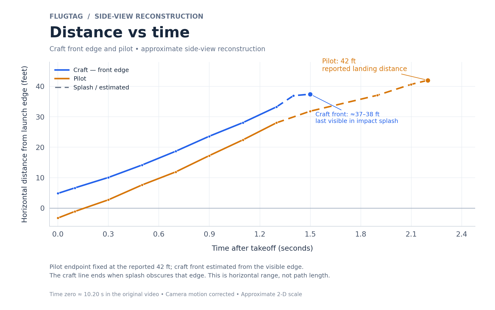
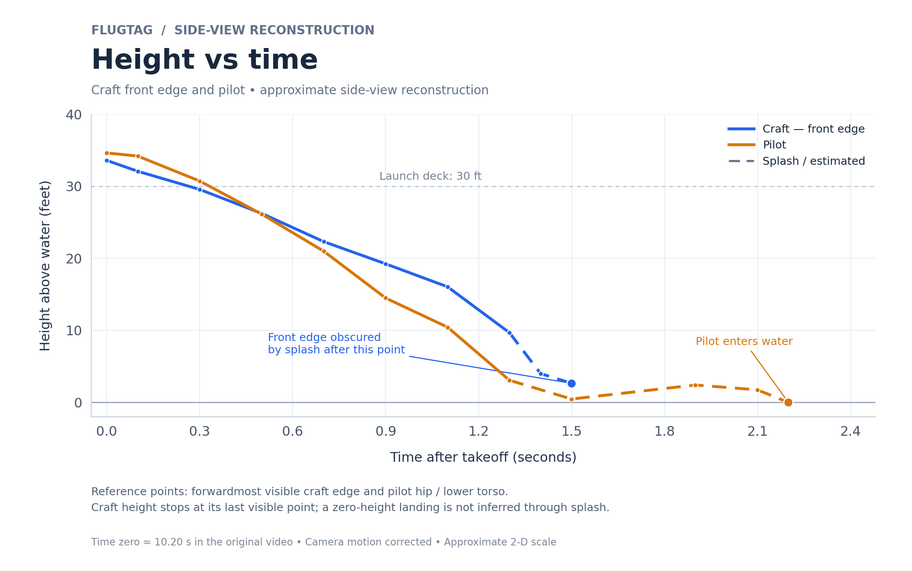

# Flugtag computer vision program

**FlightLab** is a local Python desktop app for identifying, tracking, and reviewing objects in flight videos. Track a custom craft, pilot, launch cart, or other visible object, watch their boxes during playback, and inspect measurements in a separate graph window.

## Features

- YOLOX suggestions for common object classes, with manual role labels such as Pilot and Craft.
- NanoTrack for compact objects and CSRT for wide selections; corrections retain track IDs.
- Side-view trajectory trails and top-view boxes without measurement clutter.
- Per-shot tracking, explicit lost/occluded states, and keyframe-assisted full-video review.
- Approximate planar calibration, separate motion graphs, CSV/JSON exports, and overlay video recording.
- A reproducible Flugtag distance/height example with separate craft-front and pilot curves.

This is assisted tracking. The detector does not automatically determine which person is the pilot or reliably recognize a custom-built craft. Real-time processing speed depends on the hardware and number of objects; 30 FPS is not guaranteed. Full 3-D reconstruction is not implemented.

## Install and run

Use **Python 3.11–3.13 with Tkinter**. Clone or download this repository, then on Windows double-click **Start FlightLab.cmd**. It creates a local virtual environment and installs the pinned dependencies on first run.

Alternatively:

```powershell
python -m venv .venv
.venv\Scripts\python -m pip install -r requirements.txt
.venv\Scripts\python app.py
```

On macOS/Linux, use `.venv/bin/python` instead; the Python installation must include Tkinter.

1. Open a video and pause on a clear frame.
2. Enter a label and draw a box for each object, or use **Identify objects** for class suggestions.
3. Choose **Side view** or **Top view**, then press **Play**.
4. Pause and use **Correct selected box** if a track drifts.
5. Open **Measurements & graphs** for plots and calibration. Export results when ready.

Models are included, so analysis runs locally after installing dependencies. Source footage and rendered videos are not included. See the [user guide](docs/USER_GUIDE.md) for controls, corrections, calibration, and exports.

## Example distance and height graphs

The example uses a supplied 30-foot platform height and anchors the pilot's landing at the reported **42 feet**. The forwardmost visible craft edge projects to approximately **37–38 feet** during the impact splash. Its curve stops when that edge becomes obscured. The 42-foot endpoint is a calibration input, not independent validation.




These are approximate single-view, camera-corrected measurements. Perspective, wing depth, rotation, and occlusion limit accuracy. See the [measurement method and limitations](measurements/README.md), [CSV](measurements/distance_height_data.csv), and [two-page PDF](measurements/Flugtag_distance_and_height.pdf).

Regenerate the graphs without the source footage:

```powershell
python measurements/make_graphs.py
```

## Reproduce the reviewed tracking

The bundled keyframe project is specific to the original 54-second Flugtag clip. If you have that matching footage, put it at `media/flight.mp4`, then run:

```powershell
python review_video.py --project flugtag_review_keyframes.json --output reviewed_flight
```

For another video, create or edit the keyframe project rather than reusing selections from a different clip. **Open Prepared Demo.cmd** loads the matching clip at its overhead view. Generated footage, caches, and personal videos are ignored by Git.

## Development

```powershell
python -m unittest discover -v
```

Core files: `app.py` (Tkinter interface), `engine.py` (tracking and calibration), `tracking.py` (models), and `review_video.py` (assisted review). See [validation notes](docs/VALIDATION.md) and the [multi-view design](DESIGN.md).

Third-party models retain their included licenses; see [model credits](models/README.md). A project-wide license for the application code has not been selected.
